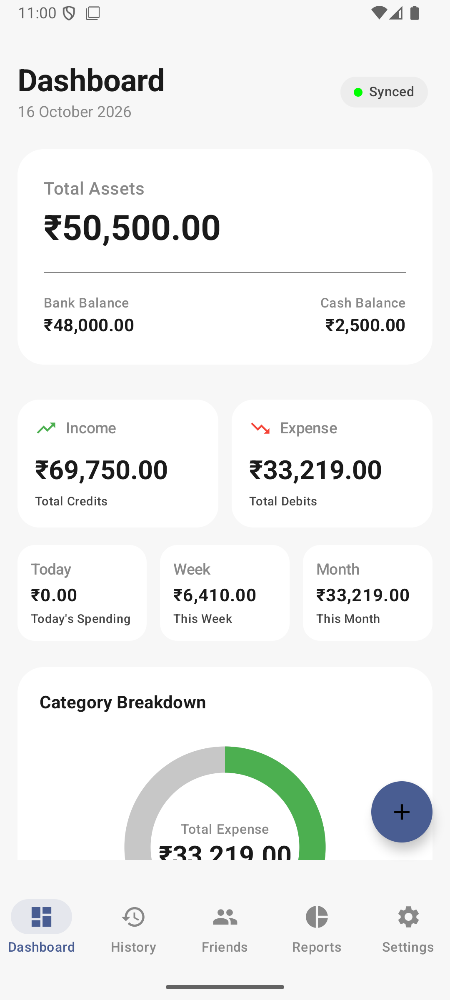
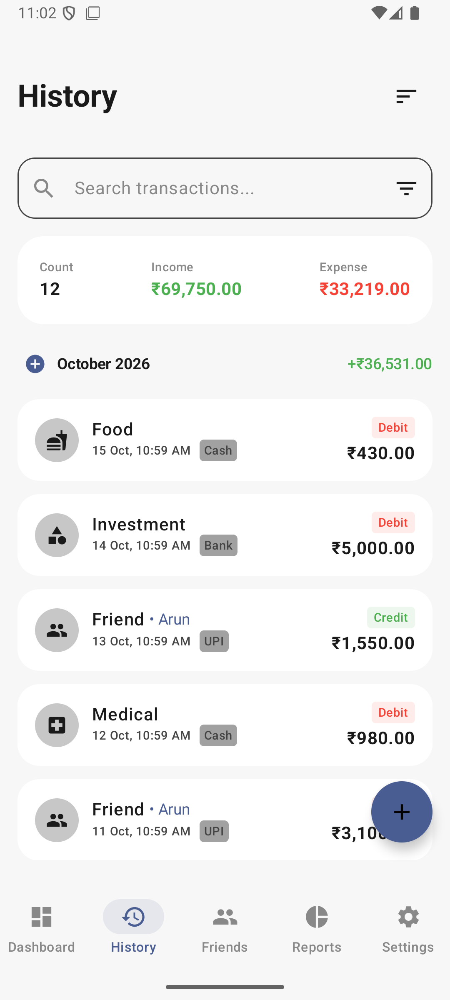
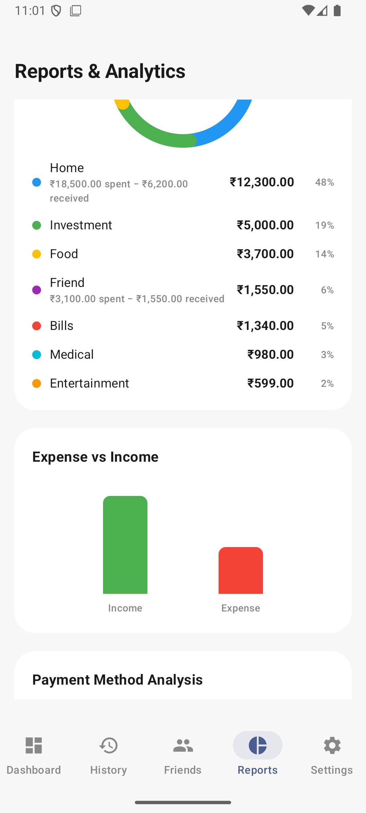
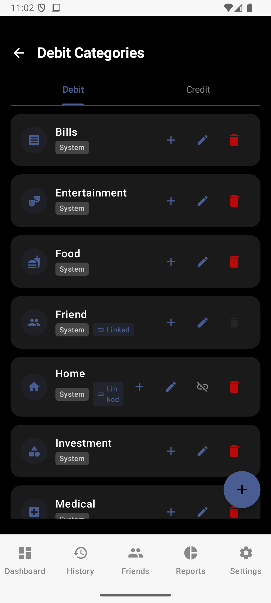
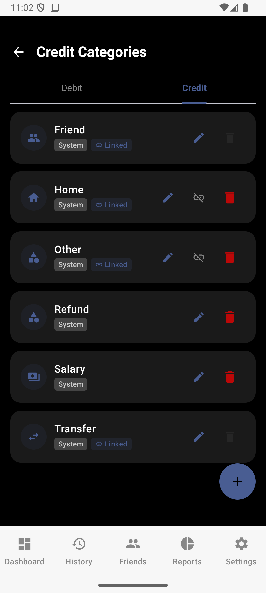
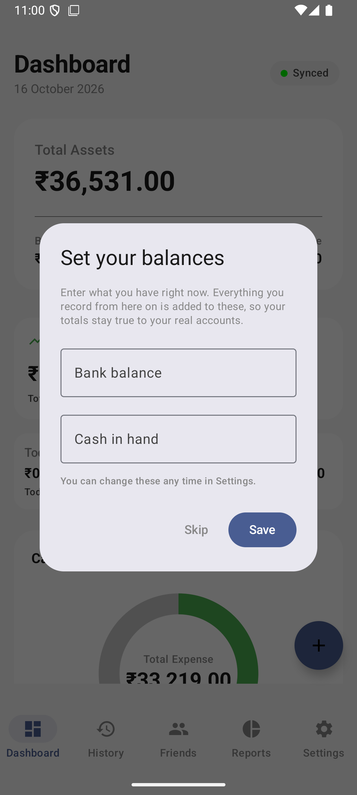

# Essential Expense Tracker

An offline-first personal finance tracker for Android that keeps a full two-way mirror of your
data in a Google Sheet — so the record survives losing your phone, and you can read or edit it
from a spreadsheet when the app isn't the right tool.

Built with Kotlin and Jetpack Compose. No ads, no accounts, no server: the only thing your data
touches is your own Google Drive.

<p align="center">
  
  
  
</p>

---

## What it does

**Tracks debits and credits** against categories, payment methods and friends, with search,
filtering and month grouping.

**Links a category across both sides of the ledger.** If "Home" exists as both a spending and an
income category, it's one category, and Reports nets the two together — ₹18,500 of rent minus
₹6,200 of flatmate contributions reads as ₹12,300, with both figures still shown rather than
hidden. The same applies to lending and being repaid.

<p align="center">
  
  
  
</p>

**Asks what you have today, not what you started with.** Nobody knows their balance before their
first ever transaction, so the app asks for the current figure and solves backwards for the
opening balance. That also means a reinstall can recover the right number.

**Syncs both ways with Google Sheets.** Changes push up as you make them; signing in on a new
device pulls everything back down — transactions, categories, friends, budgets, payment methods
and autopay rules. A reinstall is no longer a data loss event.

**Other features:** monthly budgets with threshold alerts, recurring autopay rules, friend
lending with settlement tracking, a home-screen widget, a quick-add overlay, MPIN and biometric
lock, light and dark themes, and in-app updates from GitHub Releases.

---

## Install

Download the latest APK from [Releases](https://github.com/Nithin0029/Essentialkeyexpense/releases)
and install it. Android will ask you to allow installs from an unknown source.

Requires Android 8.0 (API 26) or newer.

> **Upgrading from 3.5.0 or earlier:** 3.6.0 is signed with a new key, so Android cannot upgrade
> in place. **Open the old app and sync first**, then uninstall, install 3.6.0, and sign in to
> restore from your spreadsheet. On 3.5.0 the sync was push-only, so anything unsynced exists
> only on the device and is lost with the uninstall.

---

## Building

```bash
./gradlew assembleDebug
```

Two files are needed and neither is in the repository, because both carry credentials:

**`app/google-services.json`** — from the Firebase console, for Google Sign-In and the Sheets API.

**`keystore.properties`** in the project root, for release builds only. Copy
[`keystore.properties.example`](keystore.properties.example) and fill it in:

```properties
storeFile=your_keystore.jks
storePassword=...
keyAlias=...
keyPassword=...
```

Without it, `assembleRelease` still succeeds but produces an **unsigned** APK that Android will
refuse to install. Verify before shipping:

```bash
apksigner verify --print-certs app/build/outputs/apk/release/app-release.apk
```

Full release procedure in [RELEASE.md](RELEASE.md).

---

## How it's put together

| Layer | |
|---|---|
| UI | Jetpack Compose, Material 3, single activity with Navigation Compose |
| State | ViewModels exposing `StateFlow`, unidirectional data flow |
| Data | Room — six tables, currently at schema version 16 |
| DI | Hilt |
| Sync | Google Sheets API v4, with WorkManager for background pushes |
| Updates | Retrofit against a `version.json` in this repository |

The database is the source of truth. Writes go to Room first and are queued for sync by a
`syncStatus` column, so the app works offline and reconciles later.

Two tables — payment methods and autopay rules — have no `syncStatus`, so the whole set is pushed
each cycle and deletions are sent immediately rather than queued. That asymmetry is deliberate and
documented where it matters.

---

## Known issues

[KNOWN_ISSUES.md](KNOWN_ISSUES.md) is kept honest and current. Two worth knowing before you rely
on this:

**Do not use one spreadsheet from two devices.** Transaction ids are generated per device and will
collide, which silently corrupts both copies. Single-device use only until that's fixed.

**Deleting a row in the spreadsheet deletes it on the device.** This direction has not been
verified against a live sheet, only emulated. It is guarded — it refuses if more than half your
transactions would go — but treat it carefully.

---

## Privacy

There is no server and no analytics. Data lives in Room on your device and in a Google Sheet in
your own Drive, created by the app and visible only to you. Sign-in uses Google's OAuth flow; the
app never sees your password and requests only the Sheets and Drive scopes it needs.

The screenshots above use fabricated data.
